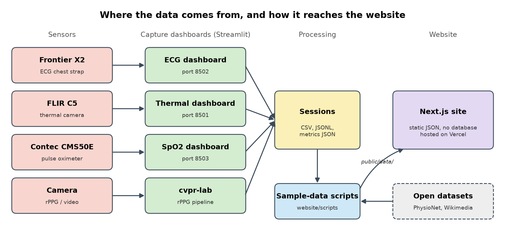
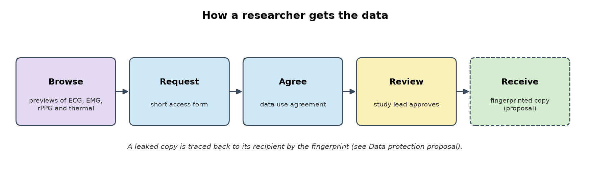
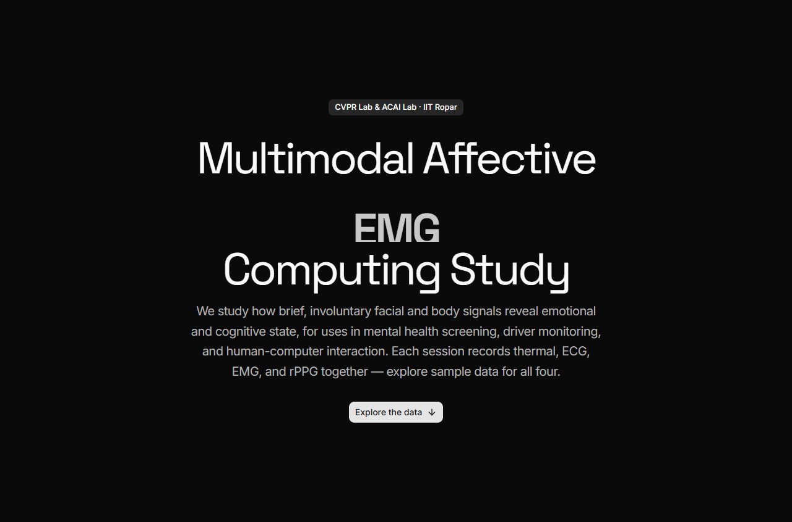
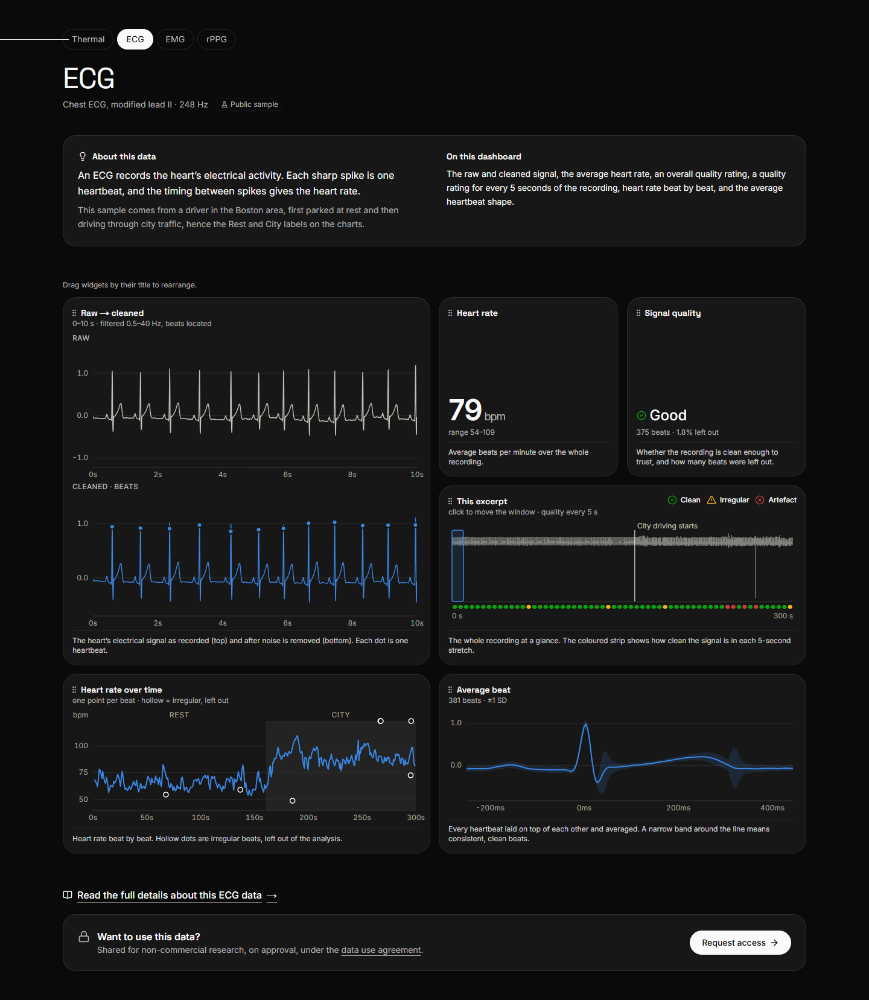
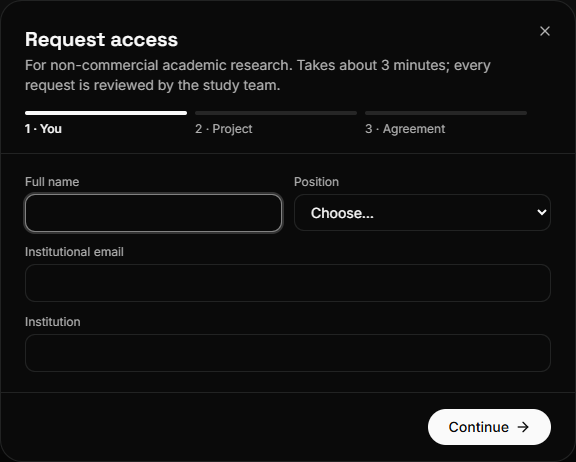
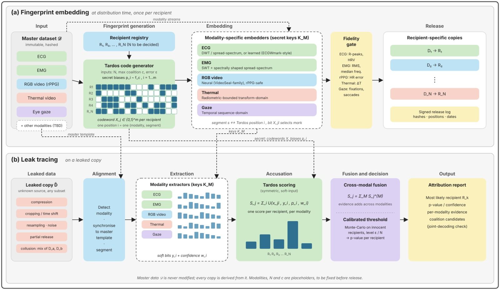
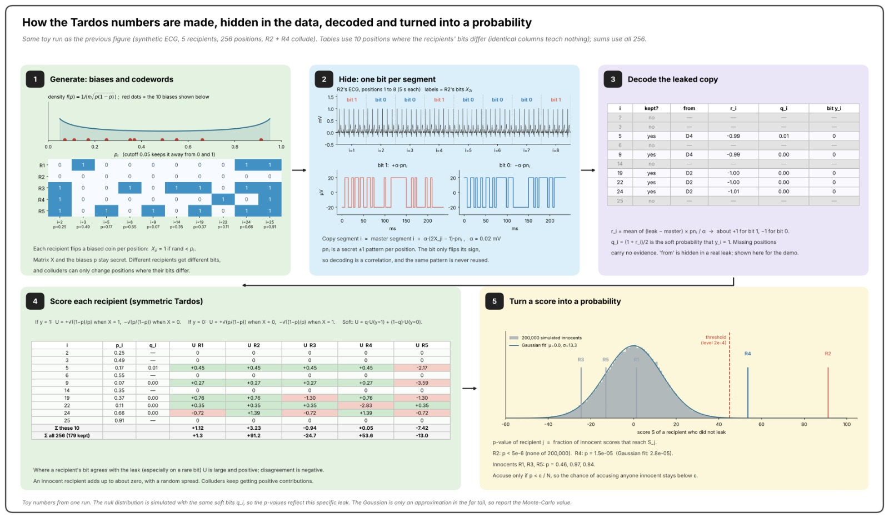

# MMAC Study Hub

### 🌐 Live website: **https://multimodal-analysis-dashboards.vercel.app/**

The public website for the **Multimodal Affective Computing (MMAC) study** at
IIT Ropar. The study looks at how brief, involuntary facial and body signals
relate to emotional and cognitive state, and records several signals together:

| Signal | What it measures |
|---|---|
| **Thermal** | Skin temperature across the face, from a heat camera |
| **ECG** | The heart’s electrical activity, beat by beat |
| **EMG** | Small muscle movements, from electrodes on the skin |
| **rPPG** | The pulse, from an ordinary camera, with nothing touching the skin |

The repository has two parts. The **Study Hub website** (`website/`) is where
people who want the study’s data can **preview it**: what
each signal looks like, what a recording contains and how clean it is. Access to
the full dataset is by request, under a data use agreement. The **capture
dashboards** (`ECG/`, `SpO2/`, `Thermal/`) are the tools that recorded the data.
They are no longer linked from the site.

This repository is a supplement to our main project,
[**Aura Screen**](https://github.com/hima1323/health-screening), a contactless
health pre-screening app. We built the data-collection side while helping our
professor run the study.

## Problem statement

Researchers outside the team need to see what the study’s data looks like, and
how clean it is, before asking to use it. The study also needs to control who
receives the data, and to be able to tell where a copy came from if it leaks.
The first versions fell short:

- The data was offered as open downloads, with no terms of use.
- Visitors struggled to find the data, and to understand it once they did.
- Each signal had a separate recording dashboard that showed numbers without
  explaining what they meant.

## Objectives

1. **One page per signal,** focused on how clean the recording is, with
   plain-language explanations of every chart.
2. **Easy to find:** every data page reachable from the home page and the
   navigation.
3. **Controlled access:** a short request form and a data use agreement
   instead of open downloads.
4. **Traceable data:** every released copy can be tied back to its recipient
   (see [Data protection proposal](#data-protection-proposal)).
5. **Readable and accessible** in both light and dark themes.
6. **Tested with users,** with every change documented and reversible.

## Team members

| Name | Entry number |
|------|--------------|
| Nongmaithem Hans | 2024AIB1011 |
| Himanshu Patel | 2024AIB1007 |

CVPR Lab & ACAI Lab, School of AI & Data Engineering, IIT Ropar.

## Technologies used

| Layer | Tools |
|-------|-------|
| Website | Next.js 16, React 19, TypeScript, Tailwind CSS 4, Radix UI, Motion |
| Charts | Custom SVG chart components |
| Sample data | Python, NumPy, SciPy, PyTorch, OpenCV (scripts in `website/scripts/`) |
| Hosting | Vercel (the `website/` folder) |

The site is fully static, with no database or server-side secrets. Until the
study’s own recordings are released, the pages show samples from open datasets:
PhysioNet *drivedb* (ECG), PhysioNet *GRABMyo* (EMG) and a public-domain thermal
video from Wikimedia Commons.

## Workflow

### Architecture



The capture dashboards record each sensor into per-subject sessions. The
sample-data scripts turn sessions, and open datasets while the study’s own
recordings are unreleased, into static JSON that the website reads. The website
has no database or server-side secrets.

### Data access flow



## Screens

The website, in the order a visitor meets it.

### 1. Home and navigation

| Hero | Signals list | Data menu |
|:-:|:-:|:-:|
|  |  |  |

### 2. One page per signal

| ECG | EMG |
|:-:|:-:|
|  |  |

| rPPG | Thermal video |
|:-:|:-:|
|  |  |

### 3. Controlled access to the data

| Request form | Agreement step | Data use agreement |
|:-:|:-:|:-:|
|  |  |  |

## Data protection proposal

**Status: proposal.** Nothing below is built into the released data yet. The
modalities, the number of recipients (N) and the maximum coalition size (c) are
placeholders, to be fixed before release.

The data use agreement says who may use the data. It cannot show who leaked it.
We propose to **watermark and fingerprint** each released copy, so that a leaked
copy can be traced back to the recipient it was issued to.

- The master dataset is immutable and is never modified. Every copy is derived
  from it.
- Each recipient gets a unique **Tardos code**, a collusion-resistant
  fingerprinting code. Each position in the code is one segment of one modality,
  and its bit decides which of two tiny marks is hidden in that segment.
- Each modality has its own embedder, driven by secret keys: spread-spectrum or
  ECGWmark-style for ECG, spectrally shaped spread-spectrum for EMG, a
  VideoSeal-family neural watermark for RGB video (chosen to survive rPPG),
  radiometric-bounded for thermal, and a sequence-domain method for gaze.
- A **fidelity gate** checks the marks do not damage the science: ECG R-peaks
  and HRV, EMG RMS and median frequency, rPPG heart-rate error, thermal
  temperature error, and gaze fixations and saccades.
- Each release is written to a signed log (hashes, positions, dates).

### Embedding and tracing



**(a)** At distribution time, once per recipient. The code generator and
modality embedders produce a recipient-specific copy, after the fidelity gate.
**(b)** On a leaked copy, of unknown source and any subset of the data: align it
to the master template, extract soft bits with confidence from each modality,
score every recipient with a symmetric soft-input Tardos score, fuse the scores
across modalities, and apply a Monte-Carlo-calibrated threshold. The output is
the most likely recipient, a p-value and per-modality evidence. Dashed lines in
the figure carry the secrets (codewords, biases, keys and the master template)
from (a) to (b). Tracing is designed to survive compression, cropping and time
shifts, resampling and noise, partial release, and collusion between recipients.

### Worked example



A toy run on a synthetic ECG with 5 recipients and 256 positions, where R2 and R4
collude: (1) generate the secret biases and codewords, (2) hide one bit per
segment, (3) decode the leaked copy into soft bits, (4) score each recipient, and
(5) turn each score into a p-value. In this run R2 is accused at p < 5e-6, R4 at
p = 1.5e-05, and the innocent recipients at p = 0.46, 0.97 and 0.84. We accuse
only if p < ε / N, so the chance of accusing anyone innocent stays below ε. The
null distribution is simulated, so the Gaussian fit is an approximation in the
far tail and the Monte-Carlo value is the one to report.

## Structure

```
.
├── website/           Next.js Study Hub (see website/README.md)
│   ├── src/           app routes (thermal, ecg, emg, rppg, data-agreement), components
│   ├── public/data/   static sample data the pages read
│   └── scripts/       Python scripts that build the sample data from open datasets
├── ECG/               Frontier X2 capture + Streamlit dashboard
├── Thermal/           FLIR C5 extraction + Streamlit dashboard
├── SpO2/              Contec CMS50E capture + Streamlit dashboard
├── health-screening/  Aura Screen patient app (also at hima1323/health-screening)
├── assets/            images used in this README
└── Documentation.md   initial project documentation
```

## Setup and execution

### Prerequisites

| Needed for | Requirement |
|---|---|
| Website | Node.js 20.9 or newer, and npm |
| Dashboards and data scripts | Python 3.10 or newer, and pip |
| Thermal sample-data script only | `ffmpeg` on your `PATH` |
| SpO2 dashboard only | Silicon Labs CP210x USB driver, and the CMS50E plugged in |

Tested from a fresh clone on Windows 11 with Node 24, Python 3.14 and npm 11.
Commands below are for Windows PowerShell. On macOS or Linux, use
`python3` and `source .venv/bin/activate` instead of `.\.venv\Scripts\activate`.

```bash
git clone https://github.com/h4444n55555/Multimodal-Analysis-Dashboards.git
cd Multimodal-Analysis-Dashboards
```

### 1. Run the website

```bash
cd website
npm install
npm run dev        # http://localhost:3000
```

Open http://localhost:3000. The pages are `/`, `/thermal`, `/ecg`, `/emg`,
`/rppg` and `/data-agreement`. To check the production build, which is what
Vercel runs:

```bash
npm run lint
npm run build
npm start          # http://localhost:3000
```

The site needs no environment variables. Optionally set
`NEXT_PUBLIC_HEALTH_SCREENING_URL` to where Aura Screen is hosted (default
`http://localhost:5174`).

### 2. Regenerate the website’s sample data (optional)

The pages read ready-made files from `website/public/data/`, so you only need
this to rebuild them. Run from the `website/` folder, with the originals in
`website/scripts/sources/`:

```bash
python -m venv .venv
.\.venv\Scriptsctivate        # macOS/Linux: source .venv/bin/activate
pip install numpy scipy pandas
python scripts/ecg/make_showcase.py       # ECG, uses ../ECG/ecg_analysis.py
python scripts/emg/make_showcase.py       # EMG
python scripts/thermal/make_showcase.py   # thermal, needs ffmpeg on your PATH
```

The rPPG sample (`scripts/rppg/make_showcase.py`) is not in this list. It needs
the `cvpr-lab/` pipeline, which is not part of this repository, so the rPPG data
already in `website/public/data/rppg/` is used as it is.

See [website/scripts/README.md](website/scripts/README.md) for where each sample
comes from and its licence.

### 3. Run a capture dashboard

Each dashboard is a Streamlit app with its own `requirements.txt`. Use a
separate virtual environment per folder. The example is ECG; do the same in
`Thermal/` or `SpO2/`.

```powershell
cd ECG
python -m venv .venv
.\.venv\Scripts\activate
pip install -r requirements.txt
streamlit run dashboard.py
```

| Dashboard | Folder | URL | What you need |
|---|---|---|---|
| ECG | `ECG/` | http://localhost:8502 | A Frontier X2 live-stream share link, or a `.csv` / `.jsonl` captured earlier (`sample_session.csv` is included to try it) |
| Thermal | `Thermal/` | http://localhost:8501 | FLIR C5 radiometric `.jpg` files, dropped into the dashboard or into `Thermal/images/` |
| SpO2 | `SpO2/` | http://localhost:8503 | A CMS50E on a free COM port (close SpO2 Assistant first) |

They use different ports, so all three can run at once during a session.

### 4. Capture without a dashboard (command line)

```powershell
# ECG: record 10 minutes from a share link, no browser needed
cd ECG
python stream_capture.py <share-link-or-id> -d 600 -o morning_session

# SpO2: list ports, record live, check the decoders without a device
cd ..\SpO2
python stream_capture.py ports
python stream_capture.py live -d 600 -o morning
python stream_capture.py selftest

# Thermal: extract temperatures from FLIR photos in images/ into output/
cd ..\Thermal
python extract_metadata.py --input images --output output
```

Details for each sensor are in `ECG/README.md`, `SpO2/README.md` and
`Thermal/README.md`.

## Deployment

Live at **https://multimodal-analysis-dashboards.vercel.app/**.

The site lives in the `website/` folder, so when importing the repository into
Vercel set **Root Directory** to `website`. No other settings or environment
variables are needed.

## Version control

The project is tracked with Git and hosted on GitHub:
**https://github.com/h4444n55555/Multimodal-Analysis-Dashboards** (public).

### Branches

| Branch | Purpose |
|--------|---------|
| `main` | The only branch. Stable code, and what the GitHub page and this README show. |

### Commit conventions

- One logical change per commit, so any commit can be reverted on its own.
- The subject line says what the change does, in the imperative
  (“Restore capture dashboards and add setup instructions”), not which files
  changed.
- Code, docs and screenshots are committed. Virtual environments, caches, logs
  and the `cvpr-lab/` workspace are not (see `.gitignore`).

### History

| Date | What changed | Commits |
|------|--------------|---------|
| 29 Aug 2026 | Initial multimodal biosignal capture dashboards | `93ae1f1` |
| 29 Sep 2026 | Aura Screen app, evaluation docs and hub launcher; the MMAC website | `6f0081b`, `94b4b25` |
| 6 Oct 2026 | EMG and rPPG dashboards, website updates, README | `adba7de` … `2ab982f` |
| 7 Oct 2026 | Initial project documentation | `d494db4` |
| 31 Oct 2026 | Website prepared for Vercel hosting | `c0d4769` |
| 2–3 Nov 2026 | README rewritten with setup instructions, diagrams and the data protection proposal; evaluation docs moved out of the repo | `cc47f09` … `1d4ae46` |

Run `git log --oneline` for the full list.

### Getting the code

```bash
git clone https://github.com/h4444n55555/Multimodal-Analysis-Dashboards.git
cd Multimodal-Analysis-Dashboards
```

Then follow [Setup and execution](#setup-and-execution).

## Related project: Aura Screen

Our main project is **Aura Screen**, a contactless health pre-screening app.
Patients scan a QR code at a screening station and get a plain-language report
of their vital signs, read by camera and thermal sensing.

**Repository:** https://github.com/hima1323/health-screening
