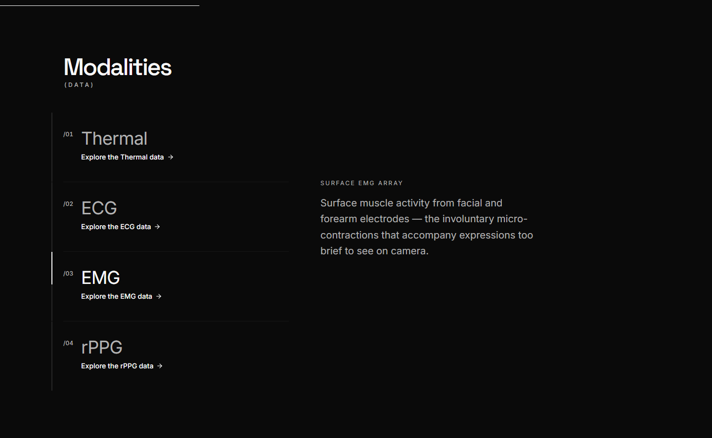
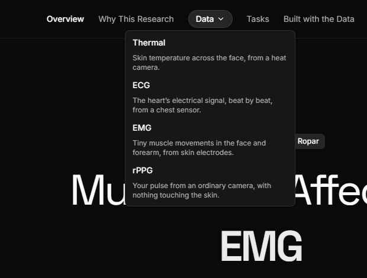
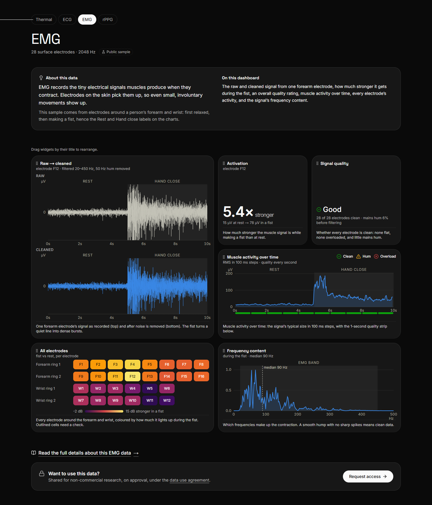
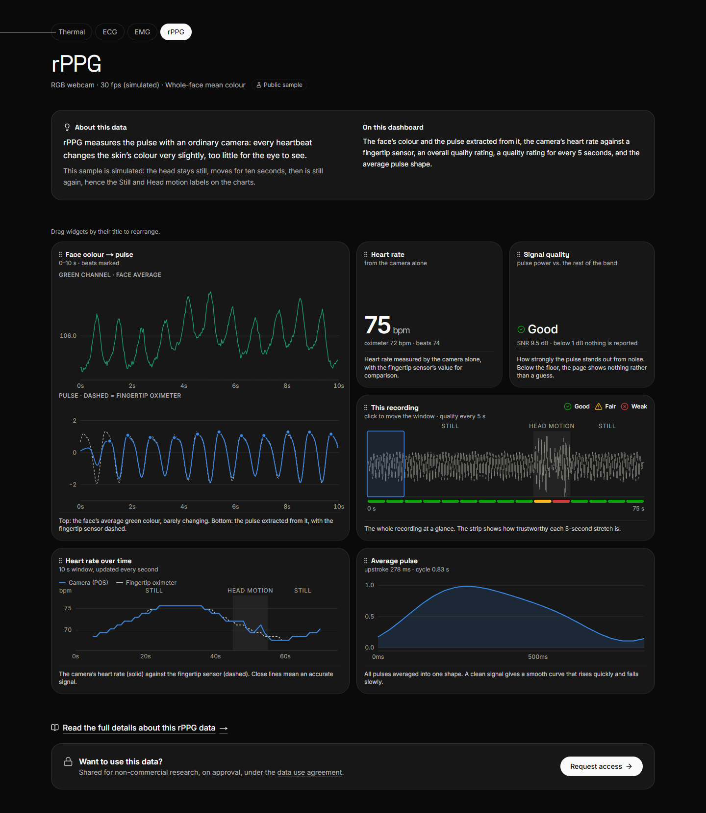
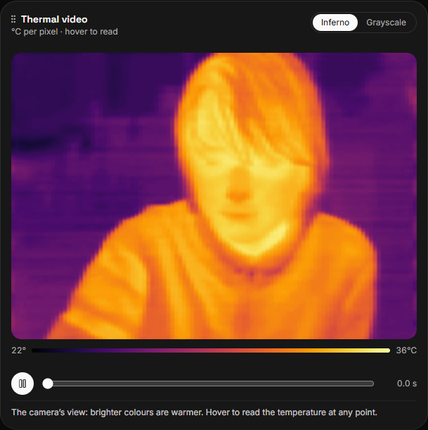
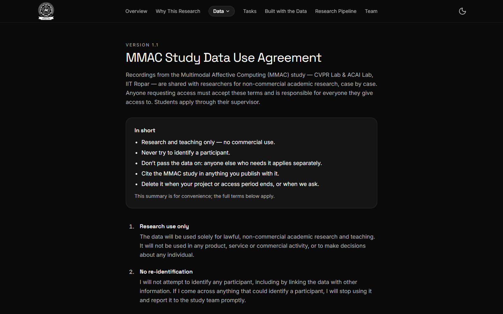

# MMAC Study Hub: Multimodal Analysis Dashboards

Capture tools, analysis dashboards and a public website for the **Multimodal
Affective Computing (MMAC) study** at IIT Ropar. The study looks at how brief,
involuntary facial and body signals relate to emotional and cognitive state, and
records four signals together:

| Signal | What it measures |
|---|---|
| **Thermal** | Skin temperature across the face, from a heat camera |
| **ECG** | The heart’s electrical activity, beat by beat |
| **EMG** | Small muscle movements, from electrodes on the skin |
| **rPPG** | The pulse, from an ordinary camera, with nothing touching the skin |

This repository is a supplement to our main project,
[**Aura Screen**](https://github.com/hima1323/health-screening), a contactless
health pre-screening app. We built the data-collection side while helping our
professor run the study: choosing the sensors, getting data out of them, and
building the dashboards and the website that presents them.

## Problem statement

Researchers outside the team need to see what the study’s data looks like, and
how clean it is, before asking to use it. The study also needs to control who
receives the data. On the collection side, the sensors we could afford were not
built for research, so getting usable numbers out of them was a project in
itself:

- The Frontier X2 chest strap keeps its raw ECG behind an app subscription. The
  only free export is a PDF of the waveform, which loses the underlying values.
- The FLIR C5 thermal camera is not a research-grade radiometric camera. It has
  no interval timer, and its USB live stream is only an 8-bit colourised image
  with no temperature values in it.
- The first dashboards were separate per-signal tools. They often failed to
  launch and showed numbers without explaining what they meant.
- The data was offered as open downloads, with no terms of use, and visitors
  struggled to find it and to understand it once they did.

## Objectives

1. **Get raw data out of each sensor** without jailbreaking devices or paying
   for exports, and keep it lossless.
2. **One dashboard per signal,** focused on how clean the recording is, with
   plain-language explanations of every chart.
3. **A public Study Hub website** where every data page is reachable from the
   home page and the navigation.
4. **Controlled access:** a short request form and a data use agreement
   instead of open downloads.
5. **Readable and accessible** in both light and dark themes.
6. **Tested with users,** with every change documented and reversible.

## Team members

| Name | Entry number |
|------|--------------|
| Nongmaithem Hans | 2024AIB1011 |
| Himanshu Patel | 2024AIB1007 |

CVPR Lab & ACAI Lab, School of AI & Data Engineering, IIT Ropar.

## Technologies used

| Layer | Tools |
|-------|-------|
| Website | Next.js 16, React 19, TypeScript, Tailwind CSS 4, Radix UI, Motion |
| Charts | Custom SVG chart components |
| Sensor capture | Python, Streamlit; FLIR C5 thermal camera, Fourth Frontier Frontier X2 ECG strap, Contec CMS50E pulse oximeter |
| Data processing | Python, NumPy, SciPy (filtering, Pan-Tompkins beat detection, heart-rate variability, EMG analysis) |
| rPPG pipeline | Python, PyTorch, OpenCV |
| Thermal extraction | Python, `flyr` (FLIR radiometric JPEG parser) |
| Hosting | Vercel (the `website/` folder) |

Until the study’s own recordings are released, the website shows samples from
open datasets: PhysioNet *drivedb* (ECG), PhysioNet *GRABMyo* (EMG) and a
public-domain thermal video from Wikimedia Commons.

## How the data is captured

### ECG: Frontier X2 chest strap

The strap’s app offers a live-stream share link. Inspecting the page showed it
receives waveform packets over a WebSocket, and the protocol was read from the
page’s own JavaScript bundle rather than guessed. A Python script connects to
the endpoint, sends one subscribe message for the user ID in the link, and
stores what arrives.

- The stream is 125 Hz, one packet per second with 125 samples.
- Each packet arrives about three times, so duplicates and out-of-order packets
  are dropped by packet number, and gaps are counted as missed data.
- The amplitude has no unit label. The dashboard treats values as mV and labels
  the axis “uncalibrated”. Raw counts are always saved.
- Beats are found with a Pan-Tompkins detector and zero-phase filtering.
  Implausible or ectopic-looking intervals are flagged and left out of the
  variability metrics.

**Checks:** a synthetic ECG with known beat times gave 216 of 216 beats found. A
real 150 s capture gave a heart-rate range of 56.4 to 91.5 bpm, against the
strap’s own reported 55 to 90 bpm.

### Thermal: FLIR C5

Raw radiometric video would have meant jailbreaking the camera and its app, which
we chose not to do. Radiometric data is, however, embedded in the camera’s still
JPEGs (a 16-bit thermal image plus calibration constants). We wrote an extractor
that turns each photo into a per-pixel temperature array and a metadata record.

The thermal dashboard adds a capture checklist, a warm-up timer, a subject and
session log (skin type, ambient temperature, distance and so on), and quality
flags (glasses, facial hair, hair over the forehead) so bad regions can be
filtered out later. Since the camera cannot record temperature video, we record
ordinary thermal video as well, and plan to train a model on the radiometric
stills to estimate per-pixel temperature for each video frame.

### SpO2: Contec CMS50E

The oximeter appears as a virtual COM port through its USB-to-serial bridge. The
capture tool reads that port directly and writes a clean per-sample CSV plus a
lossless raw archive. Decoders are checked against documented byte-to-value
vectors.

## Workflow

```
 sensors                capture + analysis                       outputs
 ───────                ──────────────────                       ───────
 Frontier X2 ECG ─────► ECG dashboard    (Streamlit, :8502) ──┐
 FLIR C5 thermal ─────► Thermal dashboard (Streamlit, :8501) ─┤
 Contec CMS50E SpO2 ──► SpO2 dashboard   (Streamlit, :8503) ──┼─► per-subject sessions
 Camera (rPPG) ───────► rPPG pipeline    (PyTorch)  ──────────┘   (CSV / JSONL / metrics JSON)
                                                                         │
                                         open-dataset samples ◄──────────┘ cleaned, shown as
                                                  │                       sample data
                                                  ▼
                                      Study Hub website (Next.js, Vercel)
                                      home · thermal · ECG · EMG · rPPG
                                      access request form + data use agreement
```

The Streamlit dashboards are for recording sessions and are not linked from the
site. The website shows static sample data only, and has no database or
server-side secrets.

## Screens

Captured from the running website, in the order a visitor meets them. These are
the versions after the user-testing changes.

### 1. Home and navigation

| Hero | Signals list | Data menu |
|:-:|:-:|:-:|
|  |  |  |

### 2. One dashboard per signal

| ECG | EMG |
|:-:|:-:|
|  |  |

| rPPG | Thermal video |
|:-:|:-:|
|  |  |

### 3. Research pipeline


### 4. Controlled access to the data

| Request form | Agreement step | Data use agreement |
|:-:|:-:|:-:|
|  |  |  |

## User testing and changes

The site was tested with users and changed in rounds. Every change was kept as a
patch so it could be reverted on its own. Each screenshot above has a matching
`-before` image in [docs/evaluation/screenshots](docs/evaluation/screenshots).

- [Change plan](docs/evaluation/website-change-plan.md): what testing found and
  what we decided to change.
- [Change log](docs/evaluation/website-changes-log.md): what was changed, and why.

## Version control

Tracked with Git and hosted on GitHub:
**https://github.com/h4444n55555/Multimodal-Analysis-Dashboards**

- Work happens on `main`, one logical change per commit, so any commit can be
  reverted on its own.
- Code, docs and screenshots are committed. Virtual environments, caches, logs
  and the `cvpr-lab/` workspace are not (see `.gitignore`).
- Run `git log --oneline` for the full history.

```bash
git clone https://github.com/h4444n55555/Multimodal-Analysis-Dashboards.git
cd Multimodal-Analysis-Dashboards
```

## Structure

```
.
├── website/          Next.js Study Hub (see website/README.md)
│   ├── src/          app routes (thermal, ecg, emg, rppg, data-agreement), components
│   ├── public/data/  static sample data the pages read
│   └── scripts/      Python scripts that build the sample data from open datasets
├── ECG/              Frontier X2 capture + Streamlit dashboard (dashboard.py)
├── Thermal/          FLIR R-JPEG extraction + Streamlit dashboard
├── SpO2/             Contec CMS50E capture + Streamlit dashboard
├── health-screening/ Aura Screen patient app (also at hima1323/health-screening)
├── docs/evaluation/  user-testing forms, test report, before/after screenshots, patches
├── Documentation.md  initial project documentation
└── start-hub.ps1     starts the website, Aura Screen and (optionally) the dashboards
```

## Run it

### The website

```bash
cd website
npm install
npm run dev        # http://localhost:3000
```

Needs Node 20.9 or newer. `npm run build` makes the production build Vercel runs.

### The capture dashboards

Each sensor folder has its own `requirements.txt` and README.

```bash
cd ECG
pip install -r requirements.txt
streamlit run dashboard.py
```

### Everything at once (Windows)

```powershell
.\start-hub.ps1                 # website + Aura Screen
.\start-hub.ps1 -Dashboards     # also the Streamlit capture dashboards
```

Website on `localhost:3000`, Aura Screen on `localhost:5174`, dashboards on
Thermal `:8501`, ECG `:8502`, SpO2 `:8503`.

## Deployment

The site lives in the `website/` folder, so when importing the repository into
Vercel set **Root Directory** to `website`. No other settings or environment
variables are needed. Optionally set `NEXT_PUBLIC_HEALTH_SCREENING_URL` to where
Aura Screen is hosted.

## Related project: Aura Screen

Our main project is **Aura Screen**, a contactless health pre-screening app.
Patients scan a QR code at a screening station and get a plain-language report
of their vital signs, read by camera and thermal sensing.

**Repository:** https://github.com/hima1323/health-screening
