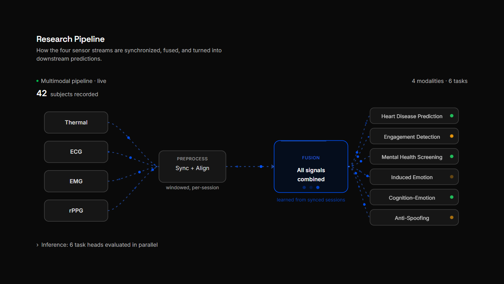

# MMAC Study Hub

The public website for the **Multimodal Affective Computing (MMAC) study** at
IIT Ropar. The study looks at how brief, involuntary facial and body signals
relate to emotional and cognitive state, and records several signals together:

| Signal | What it measures |
|---|---|
| **Thermal** | Skin temperature across the face, from a heat camera |
| **ECG** | The heart’s electrical activity, beat by beat |
| **EMG** | Small muscle movements, from electrodes on the skin |
| **rPPG** | The pulse, from an ordinary camera, with nothing touching the skin |

The Study Hub is where people who want the study’s data can **preview it**: what
each signal looks like, what a recording contains and how clean it is. Access to
the full dataset is by request, under a data use agreement.

This repository is a supplement to our main project,
[**Aura Screen**](https://github.com/hima1323/health-screening), a contactless
health pre-screening app. We built the data-collection side while helping our
professor run the study.

## Problem statement

Researchers outside the team need to see what the study’s data looks like, and
how clean it is, before asking to use it. The study also needs to control who
receives the data, and to be able to tell where a copy came from if it leaks.
The first versions fell short:

- The data was offered as open downloads, with no terms of use.
- Visitors struggled to find the data, and to understand it once they did.
- Each signal had a separate recording dashboard that showed numbers without
  explaining what they meant.

## Objectives

1. **One page per signal,** focused on how clean the recording is, with
   plain-language explanations of every chart.
2. **Easy to find:** every data page reachable from the home page and the
   navigation.
3. **Controlled access:** a short request form and a data use agreement
   instead of open downloads.
4. **Traceable data:** every released copy can be tied back to its recipient
   (see [Data protection proposal](#data-protection-proposal)).
5. **Readable and accessible** in both light and dark themes.
6. **Tested with users,** with every change documented and reversible.

## Team members

| Name | Entry number |
|------|--------------|
| Nongmaithem Hans | 2024AIB1011 |
| Himanshu Patel | 2024AIB1007 |

CVPR Lab & ACAI Lab, School of AI & Data Engineering, IIT Ropar.

## Technologies used

| Layer | Tools |
|-------|-------|
| Website | Next.js 16, React 19, TypeScript, Tailwind CSS 4, Radix UI, Motion |
| Charts | Custom SVG chart components |
| Sample data | Python, NumPy, SciPy, PyTorch, OpenCV (scripts in `website/scripts/`) |
| Hosting | Vercel (the `website/` folder) |

The site is fully static, with no database or server-side secrets. Until the
study’s own recordings are released, the pages show samples from open datasets:
PhysioNet *drivedb* (ECG), PhysioNet *GRABMyo* (EMG) and a public-domain thermal
video from Wikimedia Commons.

## How the data was collected

The data was recorded with consumer-grade sensors, using capture dashboards that
we built and have since handed over. They are not part of this repository.

- **ECG, Frontier X2 chest strap.** The raw ECG sits behind an app subscription,
  and the only free export is a PDF. The strap’s live-stream share link sends
  waveform packets over a WebSocket, so we captured those directly: 125 Hz, with
  duplicate and out-of-order packets dropped and gaps counted. Beats are found
  with a Pan-Tompkins detector. A synthetic ECG with known beats gave 216 of 216
  found, and a real 150 s capture gave 56.4 to 91.5 bpm against the strap’s own
  55 to 90.
- **Thermal, FLIR C5.** The camera cannot record temperature video, and raw
  radiometric video would have meant jailbreaking it. Radiometric data is
  embedded in its still JPEGs, so we extract a per-pixel temperature array and
  metadata from each photo, and record ordinary thermal video alongside.
- **EMG and rPPG.** Recorded alongside the other signals; the site shows
  open-dataset samples for EMG until the study’s own recordings are released.

## Screens

The website, in the order a visitor meets it.

### 1. Home and navigation

| Hero | Signals list | Data menu |
|:-:|:-:|:-:|
|  |  |  |

### 2. One page per signal

| ECG | EMG |
|:-:|:-:|
|  |  |

| rPPG | Thermal video |
|:-:|:-:|
|  |  |

### 3. Research pipeline



### 4. Controlled access to the data

| Request form | Agreement step | Data use agreement |
|:-:|:-:|:-:|
|  |  |  |

## Data protection proposal

**Status: proposal.** Nothing below is built into the released data yet. The
modalities, the number of recipients (N) and the maximum coalition size (c) are
placeholders, to be fixed before release.

The data use agreement says who may use the data. It cannot show who leaked it.
We propose to **watermark and fingerprint** each released copy, so that a leaked
copy can be traced back to the recipient it was issued to.

- The master dataset is immutable and is never modified. Every copy is derived
  from it.
- Each recipient gets a unique **Tardos code**, a collusion-resistant
  fingerprinting code. Each position in the code is one segment of one modality,
  and its bit decides which of two tiny marks is hidden in that segment.
- Each modality has its own embedder, driven by secret keys: spread-spectrum or
  ECGWmark-style for ECG, spectrally shaped spread-spectrum for EMG, a
  VideoSeal-family neural watermark for RGB video (chosen to survive rPPG),
  radiometric-bounded for thermal, and a sequence-domain method for gaze.
- A **fidelity gate** checks the marks do not damage the science: ECG R-peaks
  and HRV, EMG RMS and median frequency, rPPG heart-rate error, thermal
  temperature error, and gaze fixations and saccades.
- Each release is written to a signed log (hashes, positions, dates).

### Embedding and tracing


**(a)** At distribution time, once per recipient. The code generator and
modality embedders produce a recipient-specific copy, after the fidelity gate.
**(b)** On a leaked copy, of unknown source and any subset of the data: align it
to the master template, extract soft bits with confidence from each modality,
score every recipient with a symmetric soft-input Tardos score, fuse the scores
across modalities, and apply a Monte-Carlo-calibrated threshold. The output is
the most likely recipient, a p-value and per-modality evidence. Dashed lines in
the figure carry the secrets (codewords, biases, keys and the master template)
from (a) to (b). Tracing is designed to survive compression, cropping and time
shifts, resampling and noise, partial release, and collusion between recipients.

### Worked example


A toy run on a synthetic ECG with 5 recipients and 256 positions, where R2 and R4
collude: (1) generate the secret biases and codewords, (2) hide one bit per
segment, (3) decode the leaked copy into soft bits, (4) score each recipient, and
(5) turn each score into a p-value. In this run R2 is accused at p < 5e-6, R4 at
p = 1.5e-05, and the innocent recipients at p = 0.46, 0.97 and 0.84. We accuse
only if p < ε / N, so the chance of accusing anyone innocent stays below ε. The
null distribution is simulated, so the Gaussian fit is an approximation in the
far tail and the Monte-Carlo value is the one to report.

## Structure

```
.
├── website/           Next.js Study Hub
│   ├── src/           app routes (thermal, ecg, emg, rppg, data-agreement), components
│   ├── public/data/   static sample data the pages read
│   └── scripts/       Python scripts that build the sample data from open datasets
├── health-screening/  Aura Screen patient app (also at hima1323/health-screening)
├── assets/            images used in this README
└── Documentation.md   initial project documentation
```

## Run it

```bash
cd website
npm install
npm run dev        # http://localhost:3000
```

Needs Node 20.9 or newer. `npm run build` makes the production build that Vercel
runs. See [website/README.md](website/README.md) for the sample data.

## Deployment

The site lives in the `website/` folder, so when importing the repository into
Vercel set **Root Directory** to `website`. No other settings or environment
variables are needed. Optionally set `NEXT_PUBLIC_HEALTH_SCREENING_URL` to where
Aura Screen is hosted.

## Version control

Tracked with Git and hosted on GitHub:
**https://github.com/h4444n55555/Multimodal-Analysis-Dashboards**

Work happens on `main`, one logical change per commit, so any commit can be
reverted on its own.

```bash
git clone https://github.com/h4444n55555/Multimodal-Analysis-Dashboards.git
```

## Related project: Aura Screen

Our main project is **Aura Screen**, a contactless health pre-screening app.
Patients scan a QR code at a screening station and get a plain-language report
of their vital signs, read by camera and thermal sensing.

**Repository:** https://github.com/hima1323/health-screening
